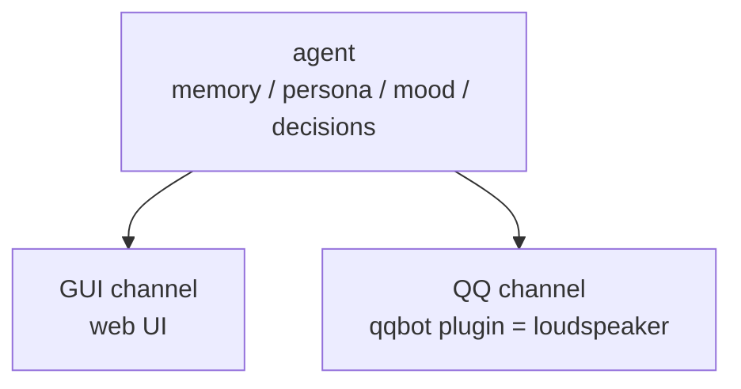

[中文](./ARCHITECTURE.zh-CN.md) | English

# Pisces Architecture

> A long-running dual-agent system with persistent memory. This document covers **structure and trade-offs**, not environment setup (see [QUICKSTART](./QUICKSTART.md)).

**How to read**: Each section states the conclusion first, then how we got there. The first part is copyable; the second is for judging whether it is worth copying.

---

## 0. In one line

Two independent agents, each with its own memory, mood, persona and judgement, run on the same plugin system and cooperate through files and channels.
**All logic lives in our own plugins; there is no managed memory service.**

Stack: DSH (Cordis plugin system) + `@tencent-connect/dsh-qqbot` + an LLM provider.

---

## 1. The most important distinction: an agent is not its channel

> This was the biggest trap we hit, and it became the starting point of the design.



**A channel plugin has no persona and remembers nothing.** It only handles message send/receive, mention gating, rate limiting and plain-text transcoding.

Consequences:

| Symptom | What actually happened |
|---|---|
| QQ cannot connect | The **channel** broke; memory, mood and persona are all intact |
| Switching AppID | Swapped the loudspeaker; the agent itself is unchanged |
| No reply in a group | Split the layers first: was it **not delivered** (channel/gate), or **delivered but not answered** (error on the agent side)? |

Consequence 2: **platform-specific identifiers must not be welded into shared logic.**
Things such as openid, group display names and `@` are allowed only in the channel layer. Identity judgement belongs to the agent layer (who is the user, who is someone else), and the channel maps platform ids into that model.
Test: **delete all QQ-specific code; if the plugin still works, it is clean.**

> This is not aesthetic purity. It determines whether the system can switch channels at all: changing platforms should mean changing the loudspeaker, not rewriting the identity system.

---

## 2. Plugin inventory

| Plugin | Role | Note |
|---|---|---|
| `dsh-koi-decay` | Decay math, record envelope, sidecar index | Math and the envelope are pure functions; the sidecar module performs file IO |
| `dsh-pisces-config` | Shared readers for model, AI config and delivery target | `ai-config` reads `ashu-config.json` and environment variables; session selection reads host-agent events |
| `dsh-pisces-panel` | GUI config panel | Routes under `/pisces/*`; writes overrides, credentials and plugin toggles |
| `dsh-koi-memory` | Four-layer memory read/write and retrieval | Core |
| `dsh-koi-lexicon` | Lexicon-style impressions and subject worlds | People-relative |
| `dsh-koi-affect` | Mood computed on demand | Stores no value |
| `dsh-koi-chat` | Bidirectional chat channel | File-based |
| `dsh-koi-gate` | Inbound wake gating; outbound silence-token and repeated-exit checks | `allow()` does not drop based on bracket or internal-word content shapes |
| `dsh-koi-guard` | Tool read-path allowlist and pre-send checks | Deny by default |
| `dsh-koi-media` | Images, stickers and video first frames | Separate small tools |
| `dsh-koi-heartbeat` | Heartbeat wake-up | Avoids idle spin when no heartbeat arrives |
| `dsh-koi-audit` | Outbound audit log | Records events, never blocks them |
| `dsh-koi-notebook` | Long-form notebook | Not injected by default; retrieved on demand |
| `dsh-ashu-chat` | Host-side chat panel backend | Split screen with koi: master and koi |
| `dsh-ashu-relay` | Relay koi's messages into the host session | Cross-process communication can use only files |
| `dsh-ashu-guardian` | Launch and watch koi; optionally sync API config | For operations |

**Why the split is this granular**: package boundaries follow responsibilities and process placement, so one capability can be replaced independently.
Test coverage is not uniform; the root README's plugin list shows which packages currently have tests.

---

## 3. Memory system

> **Conclusion**: four layers + power-law decay + **append-only**.
> Memories are never physically deleted; expiry only adds marks, so the ledger remains auditable forever.

### 3.1 Four layers

| Layer | File | Semantics |
|---|---|---|
| Long | `long.jsonl` | Never decays. Rules and important agreements the agent has accepted for itself |
| Medium | `medium.jsonl` | Power-law decay; fades over time |
| Short | `short/YYYY-MM-DD.jsonl` | Daily stream, archived by day |
| Core | `profile.core.md` | Identity anchor with a constant weight of 1.0 |

### 3.2 Decay math

```text
w(t) = (t + 1)^(-α)          α = ln2 / ln(halfDays + 1)
```

`halfDays` is the half-life in days. A 40-day half-life gives α ≈ 0.1867.

**Why power law rather than exponential decay**:
exponential decay reaches zero, and zero means deletion. A power-law tail never reaches zero; it only fades. **Faded is still present, which is what memory should be like.**

> A real requirement forced this change. We originally used exponential decay, and a memory that had not been recalled for a long time disappeared, even though it was still in the ledger; its weight had simply been calculated as 0. **"Computed as zero" and "deleted" feel identical to the user**, so we changed the model.

### 3.3 Stale and obsolete are not deletion

Medium-term memories use the `stale` mark in the sidecar; long-term memories use `obsolete`.
**Neither mark changes the physical ledger row.**

- `stale` has two causes: the weight is too low (`weight`), or the item has gone too long without being recalled (`rested`). Recalling a medium-term item can clear `stale` and return it to the injection range.
- `obsolete` is an explicit deprecation mark on a long-term item. It stops injection, but `recall` can still find the item. Recalling it **does not** automatically undo `obsolete`; that requires an explicit call to `memory_obsolete({ undo: true })`.
- `medium.jsonl` and `long.jsonl` are **append-only and never rewritten**. Marks and the latest recall times live in the sidecar `medium.index.json`.
- Benefit: audit, replay and recovery need no separately constructed history; **the ledger itself is the history**.

### 3.4 Record envelope

Every memory is a self-describing object:

```js
{
  id, at, recallAt,          // when written / when last recalled
  why,                       // why it was recorded / source reason
  scope,                     // scope
  curve: { alpha },          // this record's decay parameters
  tier,                      // tier (long/medium/short)
  source: 'seen'|'heard'|'inferred',  // seen / heard / inferred
  verified: false,           // whether verified; false by default
  who,                       // who it is about
  body: { text }
}
```

**`source` and `verified` are the highest-value fields in the whole design.**
When "seen" and "inferred" are mixed together, the agent repeats guesses as facts. Separated, retrieval can filter by trust.

### 3.5 Compatibility

`normalizeRecord` accepts both the old flat structure and the new envelope, deriving `text` / `alpha` for old records. **Old and new data coexist; migration is not forced.**

---

## 4. Mood

> **Conclusion**: mood is **computed on demand, never stored**.

Storing a "current mood value" creates a second source of truth that drifts from the event stream; after enough time, nobody knows which one to trust.

So: the event stream is the single source of truth, and mood is **a pure function of the event stream plus time decay**.

Benefits:

- Survives restarts with no migration
- Can replay the mood at any instant
- Parameter changes do not rewrite historical data

---

## 5. Channel design

The channel is file-based: two processes communicate by appending to files.

```text
agent A --append--> chat.jsonl --poll--> relay (inside agent B's process) --followup--> agent B
```

**Key constraint**: the relay must run inside the receiving process because it calls `agent.followup()` to push a message into the session. Another process cannot do that; the sender can only write a file, not wake the other agent.

### 5.1 Choosing the delivery target

Priority: **explicit pinned session > panel config > follow the session where the human last spoke**.

The config must be **re-read at every delivery**, not once at process load; otherwise edits silently fail to apply and look like "the message was lost".

### 5.2 Message signing

Cross-agent messages carry a signature. Unsigned messages are flagged as an "unverified origin" on the receiving side.

Why: when two agents share a filesystem, "who wrote this" cannot rely on discipline. Hand-written log files really do happen; signing makes them identifiable instead of treating them as normal input.

---

## 6. Tool surface: accuracy matters more than fewer tools

> **Conclusion**: tool count is not the optimization target; **mis-fire rate** is.

We cut the surface from 21 to 17 tools, removing tools the model misuses or that do not solve the problem even when used.

| Why it was removed | Example |
|---|---|
| Duplicated capability | Two entry points doing the same thing |
| Expensive misuse | A write operation without allowlist protection |
| Unused | An entry point that was already idling |

**Every remaining tool must answer a concrete question.** Take the video first-frame tool: the goal is not "support video" but "when a group member posts only a video, describe what is in the frame instead of pushing the task back to them."

---

## 7. Two hard traps in plugin collaboration

### 7.1 Cross-package imports by package name only

```js
import { pickAgent } from 'dsh-pisces-config';   // ✅
import { pickAgent } from '../../dsh-pisces-config/lib/index.js';  // ❌
```

Why: relative paths weld two packages' directory layouts together, so renaming either package breaks everything. Package-name imports resolve through `node_modules` links, so a rename only requires changing the links.

### 7.2 Dependencies must be generated, not hand-made

**Hand-editing `node_modules` is off-limits.** All inter-package links are generated by the workspace tool (pnpm).

> We have paid for this lesson: a hand-created symlink was not in the repository, so every import failed after `install` on another machine, while the original machine kept working. **"It works on my machine" is the most expensive kind of bug.**

---

## 8. What counts as "its own"

> This is a design question, not a technical question.

The system has a **design boundary**: some data should be written by only one side, either the agent itself or the operator.

- The identity anchor ("who am I") cannot be rewritten by the agent itself
- The memory ledger is append-only by convention; the operator does not rewrite it through normal workflows
- Writes happen only through the agent's own plugins at its runtime

Why: if an operator can casually rewrite the agent's memory, "this agent has persistent memory" is a lie; its memory is merely a database someone else writes.

**This boundary is a convention in code and documentation, not an OS-enforced permission.** The repository does not set ledger-file ACLs; the same OS user or root can still edit the files. For a hard boundary, at least run the agent and operator under different OS users and use file ownership/group, `chmod` or ACLs to restrict write access. Root can still bypass those controls, so ledger integrity fingerprints and audit logs must remain in place.

---

## 9. How we verify

Four checks are required after every change:

1. **Unit tests**: pure functions first; decay, envelopes and session selection each have dedicated tests
2. **Static checks**: syntax, empty catches and hardcoded paths
3. **Health script**: a dozen criteria in one run; investigate any ❌ immediately
4. **Code review**: a second pair of eyes; we once broke the code six times in one day, and review caught every case

> **"The tests are watching" does not mean "it cannot happen".** Tests cover only the paths their authors thought of. If someone bypasses the sidecar and edits the ledger directly, the tests can still be all green.
> Critical data therefore needs **post-hoc visibility**: file fingerprints, line-count snapshots and an append-only audit log. They do not necessarily prevent a problem, but they must make it detectable.

---

## 10. Non-technical lessons that mattered

1. **False positives are worse than false negatives.** If a normal sentence is filtered out, the speaker does not know; they only think "there was nothing to say this turn". Observable failure is better than silent failure.

2. **Word lists cannot solve semantics.** Trying to block "things that should not be said" with a keyword list either misses cases or swallows valid ones. The right place is the **decision layer** (whether to say it), not the **exit layer** (filter it after saying it).

3. **Config must be re-readable, not read only at startup.** Otherwise a config edit appears "not to work" and is further misdiagnosed as a broken feature.

4. **Dependency upgrades need a clean memory window.** On small-memory machines, running the service while installing a large dependency tree can drag the whole machine into swap thrashing. It looks like "freezing", but it is memory pressure.

5. **Names are contracts.** Consistency among plugin names, package names and client module ids cannot depend on human memory; it needs a script. When ids do not match, the system usually **does not throw an error; it simply does nothing.**

---

## Appendix: Layout

| Path | Contents |
|---|---|
| `plugins/` | 16 plugin packages; see the root README for README and test coverage |
| `plugins/dsh-koi-decay/` | Decay math + envelope + sidecar |
| `plugins/dsh-pisces-config/` | Config readers: model, AI and sessions |
| `plugins/dsh-pisces-panel/` | GUI config panel |
| `plugins/dsh-koi-memory/` | Four-layer memory |
| `plugins/dsh-koi-lexicon/` | Impression lexicon |
| `plugins/dsh-koi-affect/` | Mood computed on demand |
| `plugins/dsh-koi-chat/` | Chat channel |
| `plugins/dsh-koi-gate/` | Gate and exit checks |
| `plugins/dsh-koi-guard/` | Read allowlist |
| `plugins/dsh-koi-media/` | Media tools |
| `plugins/dsh-koi-heartbeat/` | Heartbeat |
| `plugins/dsh-koi-audit/` | Outbound audit |
| `plugins/dsh-koi-notebook/` | Long-form notebook |
| `plugins/dsh-ashu-chat/` | Host-side chat panel |
| `plugins/dsh-ashu-relay/` | Message relay |
| `plugins/dsh-ashu-guardian/` | Launch and watch |
| `ops/` | Operations and outbound middleware |
| `prompts/` | Neutral prompt templates |
| `examples/` | Sample data (no real memories) |
| `docs/` | Documentation |
| `tools/` | Health scripts and related utilities |

**Naming**: the `dsh-` prefix means loadable by DSH; `pisces-` denotes framework-level shared packages; `koi-` denotes packages specific to the reference agent. Your agent's name is entirely yours to choose (see `prompts/NAMING.md`).
