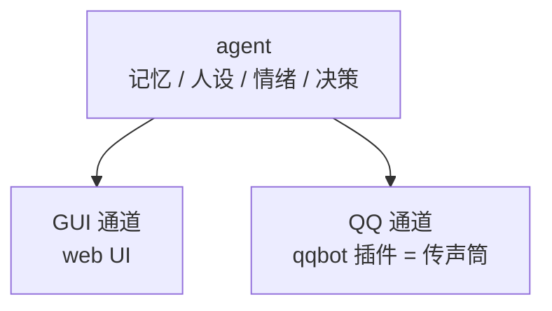

中文 | [English](./ARCHITECTURE.md)

# Pisces 架构说明

> 一个长期运行、有持续记忆的双 agent 系统。本文讲**结构与取舍**，不讲怎么配环境（见 [QUICKSTART](./QUICKSTART.zh-CN.md)）。

**阅读建议**：每节先给结论，再讲我们怎么踩到那一层的。前者给你抄，后者给你判断值不值得抄。

---

## 0. 一句话

两个独立 agent，各自有记忆、情绪、人设和判断，跑在同一个插件系统里，通过文件与通道协作。
**全部逻辑在自写插件里，没有托管记忆服务。**

技术栈：DSH（Cordis 插件系统）+ `@tencent-connect/dsh-qqbot` + LLM provider。

---

## 1. 最重要的区分：agent 和通道是两回事

> 这是踩过的最大的坑，也是整个设计的起点。



**通道插件本身没有人格、不记任何东西。** 它只做：收发消息、@ 门控、频率限制、纯文本转码。

推论：

| 现象 | 实际发生了什么 |
|---|---|
| QQ 连不上 | **通道**坏了，记忆、情绪、人设全在 |
| 换个 AppID | 换了个喇叭；agent 本身没有变 |
| 群里没回复 | 先分层：**没收到**（通道/门控）还是**收到了没回**（agent 侧报错） |

推论二：**平台特定标识符不得焊进通用逻辑。**
openid、群名片、`@` 这类东西只允许出现在通道层，身份判断走 agent 层（谁是用户 / 谁是别人），通道负责把平台 id 映射过来。
判据：**删掉所有 QQ 相关代码，插件还能工作，它就是干净的。**

> 这一条不是洁癖。它决定了系统能不能换通道，因为换平台时你只需要换传声筒，而不是重写身份系统。

---

## 2. 插件清单

| 插件 | 职责 | 备注 |
|---|---|---|
| `dsh-koi-decay` | 衰减数学、记录信封、侧车索引 | 数学与信封是纯函数；侧车模块读写文件 |
| `dsh-pisces-config` | 模型、AI 配置与会话投递目标的统一读口 | `ai-config` 读取 `ashu-config.json` 与环境变量；会话选择读取宿主 agent 事件 |
| `dsh-pisces-panel` | GUI 配置面板 | 路由 `/pisces/*`；写入 override、凭据和插件开关 |
| `dsh-koi-memory` | 四层记忆的读写与检索 | 核心 |
| `dsh-koi-lexicon` | 词典式印象、主体世界 | 与人相关 |
| `dsh-koi-affect` | 情绪现算 | 不存值 |
| `dsh-koi-chat` | 双向对话通道 | 文件为介质 |
| `dsh-koi-gate` | 入站唤醒门控；出站静默词与退场重复判定 | `allow()` 不按括号或内部词的内容形状拦截 |
| `dsh-koi-guard` | 工具读取路径白名单与发送前确认 | 越界即拦 |
| `dsh-koi-media` | 图片、表情、视频首帧 | 独立小工具 |
| `dsh-koi-heartbeat` | 心跳唤醒 | 无心跳则长驻空转 |
| `dsh-koi-audit` | 外发审计流水 | 只记录，不拦截 |
| `dsh-koi-notebook` | 长内容笔记本 | 默认不注入，按需查询 |
| `dsh-ashu-chat` | 宿主侧的对话面板后端 | 与 koi 分屏：master 与 koi |
| `dsh-ashu-relay` | 把 koi 的消息投进宿主会话 | 跨进程只能用文件 |
| `dsh-ashu-guardian` | 拉起并看护 koi；可选同步 API 配置 | 运维用 |

**为什么拆这么细**：包边界按职责和进程位置划分，让一个能力可以独立替换；
测试覆盖并不均匀，当前哪些包有测试见根 README 的插件清单。

---

## 3. 记忆系统

> **结论**：四层 + 幂律衰减 + **只增不删**。
> 记忆永不物理删除；过期只打标记，账本永远可回溯。

### 3.1 四层

| 层 | 文件 | 语义 |
|---|---|---|
| 长期 | `long.jsonl` | 永不衰减。自己认下的规矩、重要约定 |
| 中期 | `medium.jsonl` | 幂律衰减，会变淡 |
| 短期 | `short/YYYY-MM-DD.jsonl` | 当日流水，按天归档 |
| 内核 | `profile.core.md` | 身份锚点，恒权重 1.0 |

### 3.2 衰减数学

```text
w(t) = (t + 1)^(-α)          α = ln2 / ln(halfDays + 1)
```

`halfDays` = 半衰期天数。40 天半衰 → α ≈ 0.1867。

**为什么用幂律不用指数**：
指数衰减会“归零”，而归零等于删除；幂律尾巴永远不为零，只是越来越淡。**淡了还在，这是记忆该有的样子**。

> 这条是被真实需求逼出来的：早先用指数衰减，一条很久没被想起的记忆直接消失，而它本来还在账本里，只是权重算成了 0。**“计算上归零”和“删掉”对使用者的体验没有区别**，所以换了模型。

### 3.3 过时 ≠ 删除

中期记忆用侧车里的 `stale` 标记，长期记忆用 `obsolete` 标记，**物理行都不动**。

- `stale` 有两个原因：权重过低（`weight`）或长期未被想起（`rested`）。中期条目被重新
  recall 后可以清除 `stale` 并回到注入范围。
- `obsolete` 是长期条目的显式废弃标记。它停止注入，但 `recall` 仍能查到；重新
  recall **不会**自动撤销 `obsolete`，需要显式调用 `memory_obsolete({ undo: true })`。
- `medium.jsonl` / `long.jsonl` **只追加，永不重写**；标记和最近 recall 时间写在侧车
  `medium.index.json`。
- 带来的好处：审计、回溯、恢复都不需要另造历史，**账本本身就是历史**。

### 3.4 记录信封

每条记忆是一个带自描述字段的对象：

```js
{
  id, at, recallAt,          // 何时写入 / 何时最近被想起
  why,                       // 为什么记 / 来源理由
  scope,                     // 作用域
  curve: { alpha },          // 该条自己的衰减参数
  tier,                      // 层（long/medium/short）
  source: 'seen'|'heard'|'inferred',  // 亲见 / 听说 / 推断
  verified: false,           // 是否核过，默认未核
  who,                       // 关于谁
  body: { text }
}
```

**`source` 和 `verified` 是这套设计里性价比最高的两个字段。**
“亲见”和“推断”混在一起，会让 agent 把猜测当事实复述；分开之后，检索时能按可信度筛。

### 3.5 兼容

`normalizeRecord` 同时接受旧的扁平结构与新的信封结构，并为旧结构派生 `text` / `alpha`。**新旧数据共存，不强制迁移。**

---

## 4. 情绪系统

> **结论**：情绪**现算，不存值**。

存一个“当前情绪值”的坏处：它会变成第二个真相源，和事件流对不上；时间一长没人知道该信哪个。

所以：事件流是唯一真相源，情绪是**由事件流 + 时衰现算出来的纯函数**。

好处：

- 重启不丢、无需迁移
- 可以回放任意时刻的情绪
- 调参不改历史数据

---

## 5. 通道设计

基于文件的通道，两个进程通过追加写文件通信。

```text
agent A --append--> chat.jsonl --poll--> relay（在 agent B 进程内） --followup--> agent B
```

**关键约束**：relay 必须跑在接收方进程里，因为它要调 `agent.followup()` 把消息推进会话。跨进程没有这个能力，发送方只能写文件，叫不醒对方。

### 5.1 投递目标的选择

优先级：**显式固定会话 > 面板配置 > 跟随“人最后说话”的会话**。

**必须每次投递时重读配置**，不能在进程加载时读一次；否则配置改了不生效，而且看起来像“消息丢了”。

### 5.2 消息签名

跨 agent 的消息带签名。未签名消息在接收侧会被标记为“可疑来源”。

理由：两个 agent 共享文件系统时，“谁写的”不能靠自觉。手写日志文件是真实会发生的操作，签名让它可被识别，而不是被当成正常输入。

---

## 6. 工具面：不是越少越好，是越**准**越好

> **结论**：工具数量不是优化目标，**误触发率**才是。

从 21 个砍到 17 个，砍掉的是“模型容易误用、或者用了也不解决问题”的那些。

| 砍掉的理由 | 例子 |
|---|---|
| 能力重复 | 两个入口做同一件事 |
| 误用成本高 | 写操作没有白名单保护 |
| 用不上 | 已经空转的入口 |

**留着的工具要能回答一个具体问题。** 例如视频首帧：不是“支持视频”，而是“群友只发视频时，能说出画面内容，而不是把活推回去”。

---

## 7. 插件协作的两个硬坑

### 7.1 跨包引用只走包名

```js
import { pickAgent } from 'dsh-pisces-config';   // ✅
import { pickAgent } from '../../dsh-pisces-config/lib/index.js';  // ❌
```

原因：相对路径把两个包的目录结构焊死，任何一个包改名就全断。包名引用则由 `node_modules` 链接解析，改名只需改链接。

### 7.2 依赖要能被“生成”，不能靠手建

**手改 `node_modules` 是禁区。** 所有包间链接由 workspace 工具（pnpm）生成。

> 这条的代价我们付过：手工建的软链不在仓库里，换台机器 `install` 之后所有 import 全部失败，而本机一直是好的。**“我这里能跑”是最贵的 bug**。

---

## 8. 什么算“它的”

> 这是一个设计问题，不是技术问题。

系统里有一条**设计边界**：某些数据只应由 agent 自己或运维方的一方写。

- 身份锚点（“我是谁”）不可被 agent 自己改写
- 记忆账本以追加写为约定；运维方不通过正常流程改写
- 写入只走 agent 自己的插件，在其运行时发生

理由：如果运维方可以随手改 agent 的记忆，“这个 agent 有持续记忆”就是一句假话，它的记忆只是别人写进去的数据库。

**这条边界在代码和文档里是约定，不是 OS 强制权限。** 仓库没有设置账本文件 ACL，
同一 OS 用户或 root 仍可直接改写文件。需要硬隔离时，至少把 agent 与运维方放到不同
OS 用户下，再由文件 owner/group、`chmod` 或 ACL 限制写权限；root 仍可绕过，因此
账本完整性指纹和审计日志仍需保留。

---

## 9. 验证方式

改完必须跑四样：

1. **单元测试**：纯函数优先，衰减/信封/会话选取都有独立测试
2. **静态检查**：语法、空 catch、写死路径
3. **体检脚本**：十几条判据一次跑完，有 ❌ 当场处理
4. **代码审查**：第二双眼睛；我们自己一天内连续改坏过六次，都是审查抓到的

> **“测试盯着”不等于“不会发生”。** 测试只测它想到的那条路。哪天真有人绕过侧车直接改账本，测试照样全绿。
> 所以关键数据要有**事后可见性**：文件指纹、行数快照、追加式审计日志。它们不一定阻止问题，但必须能让人看出来。

---

## 10. 几条不算技术但很要紧的

1. **误伤比漏放更坏。** 过滤掉一句正常的话，说话者不会知道，只会觉得“这轮没话说”。可观测的失败比无声的失败好。

2. **词表解不了语义。** 想用关键词表拦住“不该说的话”，必然要么漏、要么吞。正确的位置是**决策层**（要不要说），不是**出口层**（说了再筛）。

3. **配置要能重读，不能只在启动时读一次。** 否则改配置看起来“没生效”，进一步被误判成功能坏了。

4. **依赖升级要有干净的内存窗口。** 小内存机器上，边跑服务边装大依赖树会把整机拖进 swap 抖动；看起来像“卡死”，其实是内存压力。

5. **命名是契约。** 插件名、包名、客户端模块 id 之间的一致性靠人记是记不住的，必须有脚本检查。名字对不上时，系统通常**不报错，只是什么也不发生**。

---

## 附录：目录结构

| 路径 | 内容 |
|---|---|
| `plugins/` | 16 个插件包；README 与测试覆盖见根 README |
| `plugins/dsh-koi-decay/` | 衰减数学 + 信封 + 侧车 |
| `plugins/dsh-pisces-config/` | 配置读口：模型、AI 与会话 |
| `plugins/dsh-pisces-panel/` | GUI 配置面板 |
| `plugins/dsh-koi-memory/` | 四层记忆 |
| `plugins/dsh-koi-lexicon/` | 印象词典 |
| `plugins/dsh-koi-affect/` | 情绪现算 |
| `plugins/dsh-koi-chat/` | 对话通道 |
| `plugins/dsh-koi-gate/` | 出入口判定 |
| `plugins/dsh-koi-guard/` | 读取白名单 |
| `plugins/dsh-koi-media/` | 媒体工具 |
| `plugins/dsh-koi-heartbeat/` | 心跳 |
| `plugins/dsh-koi-audit/` | 外发审计 |
| `plugins/dsh-koi-notebook/` | 长内容笔记本 |
| `plugins/dsh-ashu-chat/` | 宿主侧聊天面板 |
| `plugins/dsh-ashu-relay/` | 消息投递 |
| `plugins/dsh-ashu-guardian/` | 拉起与看护 |
| `ops/` | 运维与出站中间件 |
| `prompts/` | 中性提示词模板 |
| `examples/` | 示例数据（不含真实记忆） |
| `docs/` | 文档 |
| `tools/` | 体检等脚本 |

**命名约定**：`dsh-` 前缀表示可被 DSH 加载；`pisces-` 是框架级共用包；`koi-` 是参考实现 agent 的专属包。你的 agent 叫什么完全由你定（见 `prompts/NAMING.md`）。
