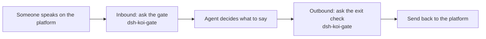

[中文](./CHANNEL.zh-CN.md) | English

# Wiring Up Your Own Channel

> The channel layer in this repository does exactly one thing: **turn platform messages into text the agent understands, and send the agent's words back to the platform.**
> Persona, memory and judgement never live in a channel.

The reference implementation uses `@tencent-connect/dsh-qqbot` (QQ). This document explains how to wire up something else: Telegram, Discord, Slack, desktop, command line, and so on.

---

## 1. Two directions, two checkpoints



**These are two independent checkpoints; do not confuse them:**

| Checkpoint | Package | Question | Where it is called |
|---|---|---|---|
| Gate | `dsh-koi-gate` (`createGate`) | **Should** this message wake the agent? | Inbound, before the message reaches the agent |
| Exit | `dsh-koi-gate` (`allow`) | **May** this sentence be sent? | Outbound, before it reaches the platform |

---

## 2. Why the channel must call both

All DSH events are **notifications** (`user/message` and `assistant/message` can neither rewrite content nor block a flow).
Therefore:

- To stop the agent from seeing a message, the channel can only decline to hand it over **when receiving it**
- To stop a sentence from being sent, the channel can only drop it **before sending**

This is not a design flaw; it is a clear division of responsibility: **the decision logic lives in the package, and the stopping point lives in the channel.**

The good news is that each channel needs only **two calls**, and none of the decision logic.

---

## 3. Minimal integration

### Outbound (required)

```js
import { allow } from 'dsh-koi-gate';

async function send(text, target) {
  const verdict = allow(text, { target });
  if (verdict.drop) {
    // Do not send, and do **not** append a replacement sentence.
    // A blocked sentence was never meant to be seen; a replacement only reveals that it existed.
    console.log(`[outbound] drop (${verdict.reason}): ${text.slice(0, 40)}`);
    return;
  }
  await platform.send(target, text);
}
```

See the [dsh-koi-gate README](../plugins/dsh-koi-gate/README.md) for the possible values of `reason`.

### Inbound (required only for group chats)

```js
import { createGate } from 'dsh-koi-gate';

const gate = createGate(bot, ctx, config);

async function onMessage(msg) {
  const pass = await new Promise((resolve) => {
    let passed = false;
    gate(
      { message: msg, stop: () => { /* mark this message as not sent */ } },
      async () => { passed = true; },
    ).then(() => resolve(passed));
  });
  if (!pass) return;   // the gate says not to disturb the agent

  await agent.followup(buildPrompt(msg));
}
```

Private one-to-one chats usually do not need the gate; send them directly to the agent.

---

## 4. What inbound messages must carry

The gate needs to decide "who said this, and to whom", so the message object must carry at least:

| Field | Purpose |
|---|---|
| `kind` | `'group'` / `'c2c'`: private chats pass directly |
| `content` | Text (the gate matches names and @ mentions) |
| `senderName` | Who said it |
| `senderIsBot` | Bot messages are not accepted |
| `mentions` | Who was @ mentioned. **The key requirement is being able to tell whether the mention targets the agent itself** |
| `groupOpenid` / `senderId` | Target identifiers, used to deduplicate exit messages |

⚠️ **`mentions` is the easiest part to get wrong.** If your platform can only say "a name was mentioned" without saying whether it is *this* agent,
map it in the channel: obtain the agent's own platform id and compare it with each mention. Do not put the decision logic in a business plugin;
that is a platform detail.

Refer to `atSelf()` in `dsh-koi-gate` to see how it handles QQ's `mentions[].is_you` and the openid fallback.

---

## 5. Identity mapping belongs to the channel, not the plugin

This is the hardest rule in the whole architecture:

> **Delete every platform-specific line; if the plugin still works, it is clean.**

Therefore:

| ✅ The channel layer should | ❌ The plugin layer must not |
|---|---|
| Map platform ids to "user / someone else / bot" | Know field names such as `openid`, `user_id` or `chat_id` |
| Handle @ syntax, group display names and message types | Write `if (platform === 'qq')` |
| Apply platform rate limits, retries and message chunking | Care how many characters fit in one send |

**Test**: can this plugin logic be reused unchanged on another channel? If not, it belongs in the wrong layer.

---

## 6. Platform details to handle before sending

These are the channel's own responsibilities, not decision logic:

| Concern | Description |
|---|---|
| **Plain-text conversion** | Most platforms do not support Markdown tables or code blocks, so downgrade them |
| **Length chunking** | Split overlong messages instead of letting the platform truncate them |
| **Rate limiting** | Platforms have frequency limits; exceeding them loses messages |
| **Streaming** | If the platform supports streaming, **filter the final text**, not character by character, which can misjudge a half-finished sentence |

The last one is especially easy to get wrong: in a stream, judging a lone `(` as "a bracketed aside" causes false drops.
**Wait until a message is complete, then judge it.**

---

## 7. How to verify the integration

```bash
node ops/test-leak-guard.mjs   # basic behavior of the exit rules
node examples/walkthrough.mjs  # inspect what the decisions look like
```

Then verify three things manually:

1. **Say something**: normal content can be sent
2. **Make the agent output the silence token**: it must not appear on any channel (`allow()` is responsible only for this hard drop)
3. **@ someone else in a group**: the agent must not be woken

If all three pass, both calls are wired correctly.

> **What `allow()` actually blocks, stated explicitly to avoid confusion.**
> It hard-drops **only the silence token** (her own declaration that "I will not speak this time") and **repeated exit phrases**.
> Bracket asides and internal words are **not blocked here**. On 2026-11-21 this project explicitly removed interception based on content shapes,
> because such guesses are inaccurate and cause collateral damage; they only teach her to evade the rules. These cases rely on **prompt discipline plus post-hoc auditing** (`dsh-koi-audit` logs).
>
> If your deployment **really needs** to hard-drop bracket asides, compose the predicates yourself instead of relying on `allow()`:
>
> ```js
> import { allow, isPureAside, shouldDropLeak } from 'dsh-koi-gate';
> const drop = allow(text, { target }).drop
>   || isPureAside(text)          // the whole message is a bracket aside
>   || shouldDropLeak(text);      // contains internal words (such as cordis.patch.yml)
> ```
>
> But consider the cost: the harder the rules block, the less she learns "when not to say something".
